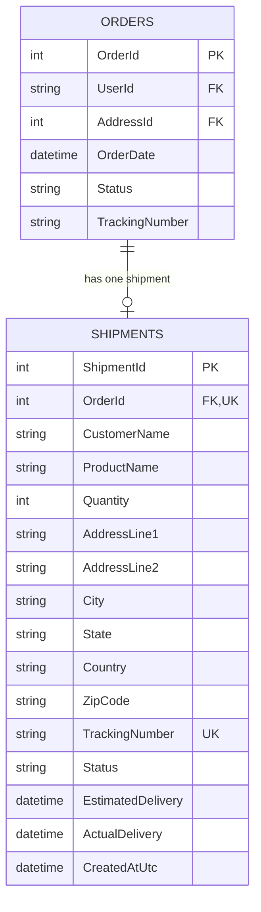

# Role 4 – Shipping Entity Relationship Diagram

## Relationship

- One `Orders` record can have zero or one `Shipments` record.
- `Shipments.OrderId` is a foreign key to `Orders.OrderId`.
- `Shipments.OrderId` is unique, preventing more than one shipment record for the same order.
- `Shipments.TrackingNumber` is unique and is the public lookup key used by the tracking endpoint.
- The existing `Orders.TrackingNumber` field is retained because the current checkout and order-history workflow already uses it. The same tracking number is saved in `Shipments.TrackingNumber` by the Shipping API.

## Normalization notes

Shipment details are stored in a separate table rather than adding all delivery fields to the Orders table. The shipment row is associated with its order using `OrderId`. Product name and quantity are stored as the shipment request summary required by the assignment; the authoritative individual order lines remain in the existing `OrderItems` table.
